# 🩺 DiagnoAI (Apna Doctor) — AI-Powered Healthcare Diagnostic & Telehealth Platform

[](https://www.python.org/)
[](https://www.djangoproject.com/)
[](https://www.tensorflow.org/)
[](https://pytorch.org/)
[](https://scikit-learn.org/)
[](https://daily.co/)
[](LICENSE)

---

## 📌 Project Overview & Motivation

In traditional healthcare systems, long waiting times for laboratory reports, limited hospital bed capacities, and geographical barriers often delay critical medical intervention. Many individuals living in remote or underserved areas lack immediate access to certified specialists.

**DiagnoAI (Apna Doctor)** is an integrated, end-to-end intelligent medical diagnostic and telehealth platform designed to bridge this gap. By combining deep learning computer vision, explainable artificial intelligence (Grad-CAM), natural language symptom processing, and real-time WebRTC HD video consultations, DiagnoAI provides rapid, accessible, and reliable preliminary health screenings directly from the browser.

---

## 🚀 Key Features

The application consists of four primary clinical modules:

### 1. 🔬 Computer-Aided Radiological & Microscopic Vision AI
- **Brain Tumor Detection & Segmentation**: Multi-class classification (*Pituitary, Meningioma, Glioma, No Tumor*) powered by ResNet50, coupled with an integrated **PyTorch UNet (512x512)** for dynamic tumor boundary localization and highlight overlay.
- **Alzheimer's Disease Staging**: 4-class MRI assessment (*Mild Demented, Moderate Demented, Non Demented, Very Mild Demented*) equipped with **Explainable AI (Grad-CAM)** heatmap visualization.
- **COVID-19 & Viral Pneumonia Screening**: Grayscale Chest X-Ray differential diagnosis (*COVID Infected, Viral Pneumonia, Lung Opacity, Healthy*) with Grad-CAM feature localization.
- **Glaucoma Optical Retinopathy**: High-resolution retinal fundus screening to identify early optic nerve damage.
- **Malaria Parasitemia Detection**: Microscopic Giemsa-stained thin blood smear cell image analysis (*Parasitized vs. Uninfected*).

### 2. 📊 Clinical Tabular Biomarker Risk Assessment
- **Cardiovascular Disease Risk**: Predictive risk scoring based on biometric and biochemical indicators.
- **Diabetes Mellitus Screening**: Fast diagnosis from metabolic markers (Glucose, Insulin, BMI, Age, Blood Pressure).
- **Breast Cancer Cytology**: Differential diagnosis using fine-needle aspirate (FNA) nuclear features.
- **Hepatic / Liver Disease**: Biochemical liver enzyme and bilirubin biomarker evaluation.
- **BMI & Biometric Index**: Body Mass Index calculation and healthy weight guidance.

### 3. 🎙️ Voice & Intelligent Multi-Symptom Differential Engine
- **Voice-to-Text Input**: Speech recognition powered by AWS Transcribe and native browser audio APIs.
- **Smart Symptom Resolver**: Fuzzy matching, alias normalization (e.g. *fever* &rarr; *high fever*, *skin rash*), and substring extraction to match over 130+ clinical symptoms.
- **Instant Precautionary Guidance**: Returns top differential disease probabilities, clinical descriptions, and recommended home precautions with ~6ms latency.

### 4. 👨‍⚕️ Telehealth Specialist Network & HD Video Consultations
- **Extensive Specialist Roster**: Real-time directory of verified specialist doctors across Tier-1 and Tier-2 Indian cities (Varanasi, Lucknow, Patna, Dhanbad, Prayagraj, Jaipur, Indore, Mumbai, Delhi, Bengaluru, Chennai, Kolkata, etc.).
- **Public Search & Discovery**: Open search by Indian city and clinical specialty with zero login wall for browsing.
- **WebRTC HD Video Consultations**: 1-click video call connections powered by Daily.co WebRTC rooms.
- **Automated Notifications**: Email confirmations and consultation links dispatched on booking.

### 5. 🔊 Interactive Cyber-Clinical Audio FX System
- **Web Audio API Sound Engine**: Zero-latency interactive feedback for hovers, clicks, toggle switches, and diagnostic completion chords.
- **Global Audio Controls**: Header speaker toggle (🔊 / 🔇) with persistent `localStorage` user preferences.

---

## 🛠️ Technology Stack

| Layer | Technologies |
| :--- | :--- |
| **Frontend** | HTML5, Modern CSS (Glassmorphism, CSS Variables), JavaScript (ES6+), Web Audio API, Lucide Icons |
| **Backend** | Python 3.10, Django 4.x, RESTful AJAX APIs |
| **Deep Learning & Computer Vision** | TensorFlow / Keras, PyTorch, OpenCV, Grad-CAM, NumPy, Pandas |
| **Machine Learning** | Scikit-Learn (Random Forest, Logistic Regression, SVM) |
| **Database** | SQLite (Default / Local), PostgreSQL compatible |
| **Telehealth & Cloud** | Daily.co WebRTC SDK, AWS Transcribe, AWS S3 |

---

## 📂 Project Directory Structure

```plaintext
Health-CheckUp/
│
├── appointment/                   # Telehealth & Doctor Scheduling App
│   ├── models.py                  # Doctor, Timeslots, Appointment DB models
│   ├── views.py                   # Public doctor search, booking, authentication
│   └── urls.py                    # Appointment routing
│
├── main/                          # Clinical Prediction Core App
│   ├── views.py                   # Handlers for 10+ disease prediction forms
│   └── urls.py                    # Disease & AI diagnostic endpoints
│
├── models/                        # Pretrained Neural Network Weights & Ensembles
│   ├── classifiers.py             # Model inference pipelines & Grad-CAM algorithms
│   ├── utils.py                   # PyTorch UNet tensor resizing & segmentation helpers
│   ├── brain_model.h5             # ResNet-50 Brain Tumor Classifier
│   ├── brain_tumor_segmentor.pt   # PyTorch UNet 512x512 Segmentation Model
│   ├── alzheimer-model.h5         # Alzheimer's MRI Classifier
│   ├── covid-model.h5             # COVID-19 & Pneumonia Chest X-Ray Model
│   ├── gl_model.h5                # Glaucoma Retinal Fundus Model
│   ├── malaria-model.h5           # Malaria Blood Smear Model
│   ├── training.csv               # Symptom dataset (132 features, 4920 rows)
│   └── *.sav / *.pkl              # Pretrained Scikit-Learn Tabular Classifiers
│
├── static/                        # Static Assets (CSS, JS, Audio)
│   ├── css/                       # Glassmorphic and responsive styling
│   ├── js/                        # sound-effects.js (Web Audio API engine)
│   ├── soundRecorder/             # Voice symptom recording scripts
│   └── videocall/                 # Telehealth Daily.co integration scripts
│
├── templates/                     # Modern Django HTML5 Templates
│   ├── base.html                  # Master layout with audio toggle & navigation
│   ├── front/index.html           # Modern landing page & feature showcase
│   ├── brain/                     # Brain tumor upload & segmentation view
│   ├── alzheimer/                 # Alzheimer's MRI & Grad-CAM view
│   ├── Covid/                     # COVID-19 X-Ray diagnosis view
│   ├── soundRecorder/             # Voice & multi-symptom differential view
│   ├── videocall/                 # Doctor directory, search, & appointment views
│   └── [heart, diabetes, etc.]/   # Tabular clinical risk assessment pages
│
├── sample_test_images/            # Curated Medical Test Images for Benchmarking
│   ├── brain_tumor/               # Sample positive and negative brain MRIs
│   ├── covid/                     # Sample COVID-19, Pneumonia, & Normal X-Rays
│   ├── glaucoma/                  # Sample normal and glaucomatous fundus images
│   ├── malaria/                   # Sample parasitized & uninfected cell smears
│   └── alzheimers/                # Sample demented & non-demented brain scans
│
├── website-screenshots/           # UI & System Demonstration Screenshots
├── checkup/                       # Django Project Configuration & Settings
├── manage.py                      # Django CLI Management Script
└── requirements.txt               # Python Dependencies
```

---

## ⚡ Getting Started

Follow the steps below to set up and run DiagnoAI locally on your machine.

### Step 1. Clone the Repository

```bash
git clone https://github.com/gautamgc17/Health-CheckUp.git
cd Health-CheckUp
```

### Step 2. Create & Activate a Virtual Environment

```bash
# Windows
python -m venv venv
.\venv\Scripts\activate

# Linux / macOS
python3 -m venv venv
source venv/bin/activate
```

### Step 3. Install Required Dependencies

```bash
pip install --upgrade pip
pip install -r requirements.txt
```

### Step 4. Download Pre-Trained Model Weights (Google Drive)

Because deep learning model weights exceed GitHub's file storage limits, all pre-trained models are hosted on Google Drive:

👉 **[Download DiagnoAI Pre-Trained Models (Google Drive)](https://drive.google.com/drive/folders/1BMVXIETJidYOkQnlsA_rUMB7buPeCSKj?usp=drive_link)**

Download and extract/place the model files directly into the `models/` directory:

| Model File | Framework | Size | Target Clinical Modality |
| :--- | :--- | :--- | :--- |
| `alzheimer-model.h5` | Keras / TF | ~1.1 GB | Alzheimer's Brain MRI Dementia Staging |
| `brain_model.h5` | Keras / TF | ~78 MB | Brain Tumor Multi-Class Classifier |
| `brain_tumor_segmentor.pt` | PyTorch | ~7.8 MB | UNet 512x512 Pixel-Level Tumor Boundary Localization |
| `covid-model.h5` | Keras / TF | ~35 MB | COVID-19 & Pneumonia Chest Radiograph Screening |
| `gl_model.h5` | Keras / TF | ~2.6 GB | Glaucoma Optic Cup/Disc Retinal Fundus Screening |
| `malaria-model.h5` | Keras / TF | ~126 MB | Malaria Giemsa Thin Blood Smear Cell Classifier |
| `cancer-model.pkl` | Scikit-Learn | ~10 KB | Breast Cancer Cytology Biopsy Classifier |
| `diabetes-model.pkl` | Scikit-Learn | ~1.9 MB | Diabetes Mellitus Metabolic Risk Assessment |
| `heart-model.pkl` | Scikit-Learn | ~2.0 MB | Cardiovascular Disease Risk Scoring |
| `liver-model.pkl` | Scikit-Learn | ~6.7 MB | Hepatic Enzyme & Bilirubin Risk Assessment |

> **Note**: Metadata CSVs (`training.csv`, `symptom_*.csv`) and python inference pipelines are already bundled in the repository.

### Step 5. Configure Environment Variables (Optional for Voice/Email)

Create a `.env` file in the root directory by copying `.env.sample`:

```ini
# AWS Transcribe & S3 Credentials (For voice symptom audio processing)
AWS_ACCESS_KEY_ID=your_aws_access_key_id
AWS_SECRET_ACCESS_KEY=your_aws_secret_access_key
AWS_REGION_NAME=us-east-1
S3_BUCKET_NAME=your_s3_bucket_name

# Email SMTP Settings (For appointment confirmation emails)
EMAIL_HOST_USER=your_email@gmail.com
EMAIL_HOST_PASSWORD=your_app_password
```

### Step 6. Run Database Migrations

```bash
python manage.py makemigrations
python manage.py migrate
```

### Step 7. Populate Doctor Directory (Sample Data)

To populate the SQLite database with 40+ specialist doctors across Tier-1 and Tier-2 Indian cities:

```bash
python manage.py shell
```
```python
# Or execute the population helper script:
import os; os.system("python scratch/populate_brahmin_surnames_doctors.py")
```

### Step 8. Start the Django Development Server

```bash
python manage.py runserver
```

Open your browser and navigate to: **`http://127.0.0.1:8000/`**

---

## 🧪 Testing with Sample Images

Pre-tested, benchmark sample images for all vision AI models are included in [`sample_test_images/`](sample_test_images/):

- **Brain Tumor**: `sample_test_images/brain_tumor/sample_brain_tumor_glioma.jpg` (Test tumor segmentation mask)
- **COVID-19**: `sample_test_images/covid/sample_covid_infected_xray.png` (Test 1-channel X-Ray & Grad-CAM)
- **Glaucoma**: `sample_test_images/glaucoma/sample_glaucoma_positive_case.jpg` (Test fundus screening)
- **Malaria**: `sample_test_images/malaria/sample_malaria_parasitized_cell.png` (Test cell parasitemia)
- **Alzheimer's**: `sample_test_images/alzheimers/sample_alzheimers_very_mild_demented.jpg` (Test cognitive staging)

---

## 📸 Website Preview

### Modern Landing & Feature Showcase
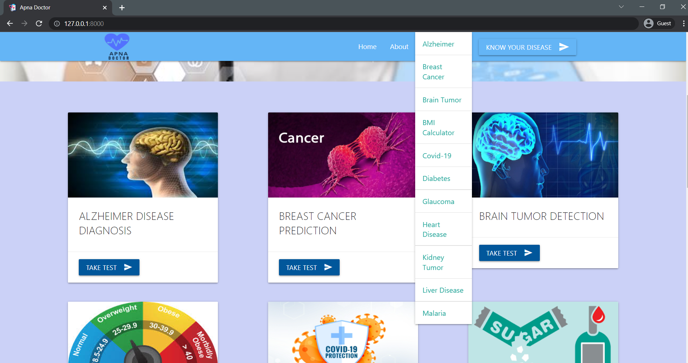

### COVID-19 & Pneumonia Vision AI
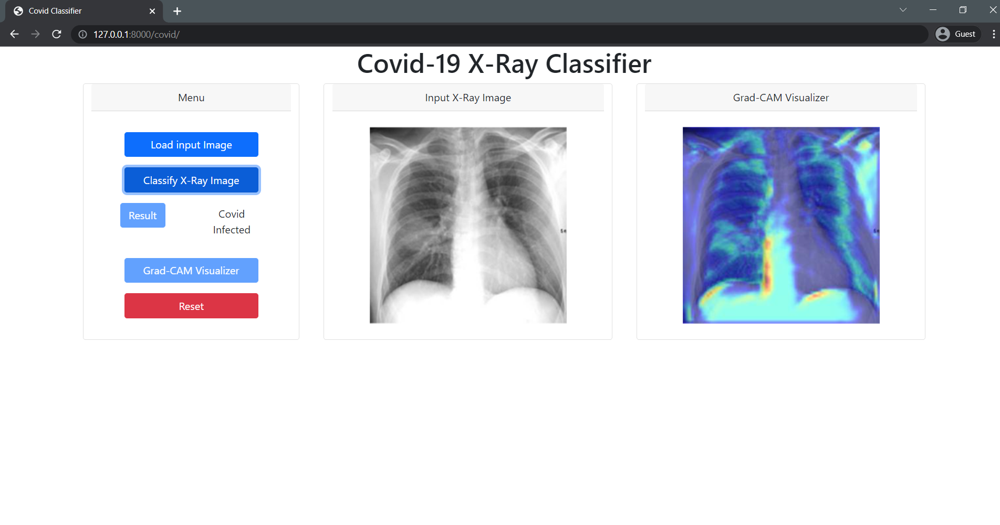

### Clinical Tabular Biomarker Assessment
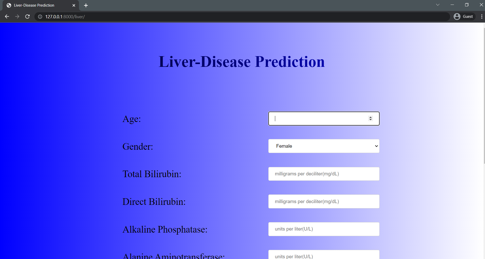
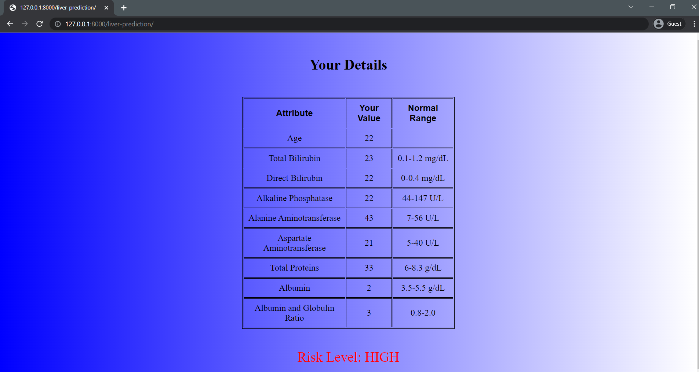

### Voice & Multi-Symptom AI Differential Diagnosis
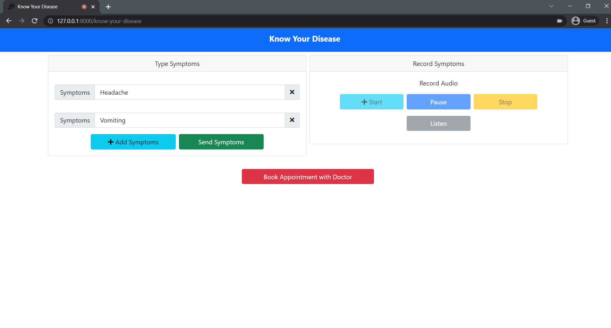
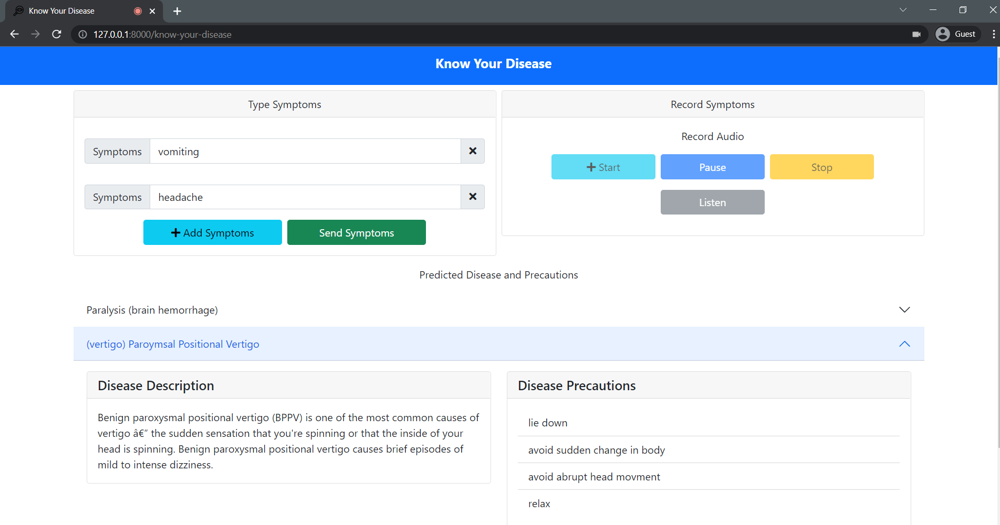
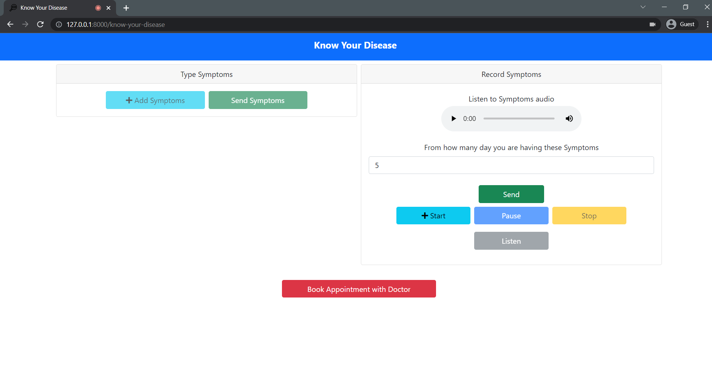

### Telehealth Specialist Directory & Filtering
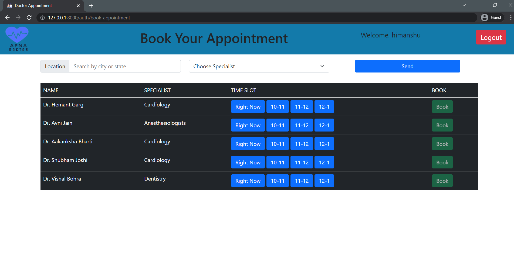
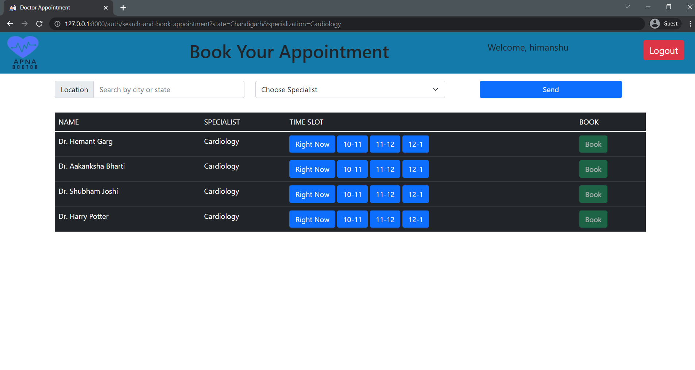

### Consultation Scheduling & HD Video Call
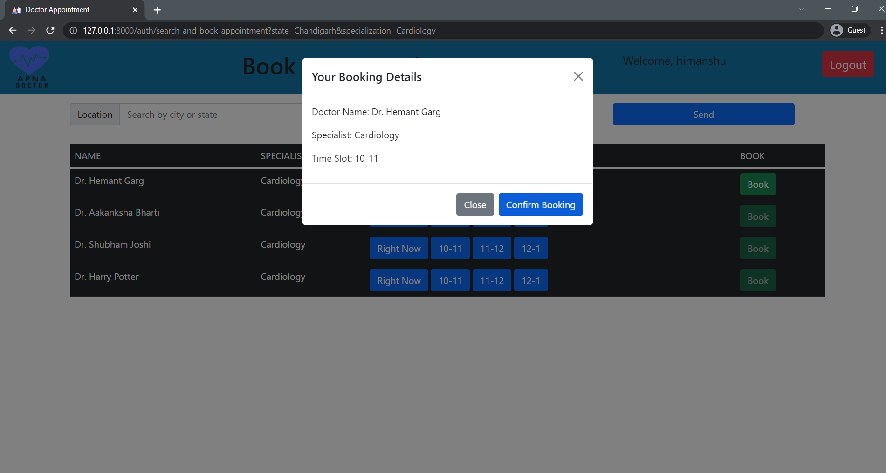
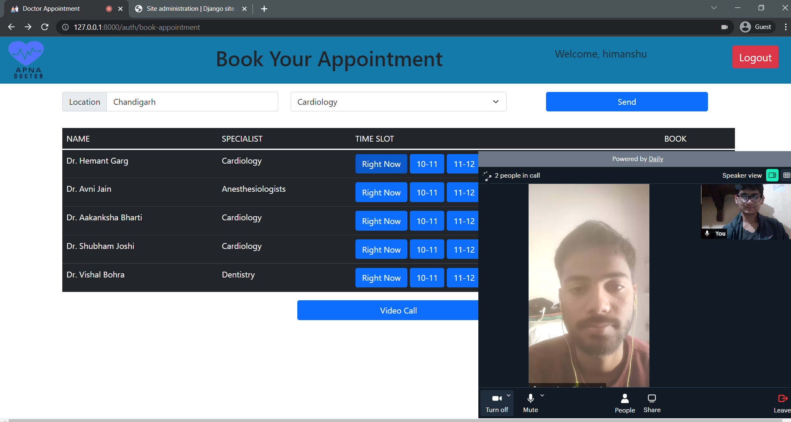

---

## 🤝 Contributing

Contributions, bug reports, and feature suggestions are welcome!
1. Fork the repository
2. Create your feature branch (`git checkout -b feature/AmazingFeature`)
3. Commit your changes (`git commit -m 'Add some AmazingFeature'`)
4. Push to the branch (`git push origin feature/AmazingFeature`)
5. Open a Pull Request

---

## 📄 License

This project is licensed under the **MIT License** — see the [LICENSE](LICENSE) file for details.

---

<p align="center">
  Built with ❤️ for AI-Assisted Healthcare Accessibility
</p>
